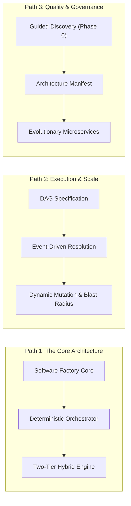

# Vault Navigation Index & Map of Content (MOC)

Welcome to the **Autonomous Software Factory Knowledge Base**. This repository codifies the architectural principles, design patterns, runtime infrastructures, and execution workflows required to design and build an industrial-grade **Agentic Software Factory**.

---

## Structure of this Knowledge Base

```
my-knowledge-base/
├── README.md                      # GitHub landing page & Map of Content (MOC)
├── attachments/                   # Diagrams, assets, or visuals
├── 00-meta/
│   └── index.md                   # Vault overview and navigation index (You are here)
└── 01-topics/
    ├── software-factory-core/     # Conceptual foundations & paradigms
    ├── orchestration-engine/      # Control planes, state machines, & hybrid runtimes
    ├── task-graph-and-dag/        # DAG specs, event resolution, & dynamic mutations
    ├── context-and-prompt-engineering/ # Contract-first scoping & JIT prompt hydration
    ├── agent-runtime-and-sandboxing/   # Ephemeral worker pools & execution sandboxes
    └── architectural-governance/  # Discovery interview, manifests, archetypes, & evolution
```

---

## Map of Content by Topic

### 1. Software Factory Foundations
- [[01-what-is-a-software-factory|What is a Software Factory?]] — Industrial manufacturing principles applied to software delivery; moving beyond artisan craftsmanship.
- [[02-agentic-software-factory-paradigm|The Agentic Software Factory Paradigm]] — The 5 core subsystems: Orchestration, Ephemeral Agents, Sandboxes, Shared Intelligence, and Human-in-the-Loop.

### 2. Orchestration Engine Architecture
- [[01-orchestration-frameworks-comparison|Orchestration Frameworks Comparison]] — In-depth evaluation: Temporal/Durable Execution vs. LangGraph/Agent Graphs vs. Custom DAG Runners.
- [[02-deterministic-macro-orchestrator|Deterministic Macro-Orchestrator Architecture]] — Why the macro-orchestrator must be deterministic code, not an AI agent.
- [[03-two-tier-hybrid-orchestration|Two-Tier Hybrid Orchestration Pattern]] — Separating Tier 1 macro-state persistence from Tier 2 micro-agent reasoning loops.

### 3. Task Graph & DAG Execution
- [[01-dag-specification-and-generation|DAG Specification and Generation]] — Turning PRDs into validated, acyclic JSON task graphs with Kahn's algorithm.
- [[02-event-driven-dependency-resolution|Event-Driven Dependency Resolution]] — How the orchestrator detects completion events and triggers parallel downstream tasks.
- [[03-dynamic-dag-mutation-and-blast-radius|Dynamic DAG Mutation and Blast Radius Analysis]] — Handling in-flight requirement changes, bidirectional ripple, and subgraph splicing.

### 4. Context & Prompt Engineering
- [[01-context-scoping-and-contract-first|Context Scoping and Contract-First Development]] — Eliminating context bloat via interface boundaries and file-ownership partitioning.
- [[02-just-in-time-prompt-hydration|Just-In-Time (JIT) Prompt Hydration]] — Why the DAG stores recipes instead of raw prompts; dynamic context compilation.
- [[03-codebase-intelligence-layer|Codebase Intelligence Layer and Shared Memory]] — Tree-sitter AST symbol graphs vs. the "God Agent" anti-pattern.

### 5. Agent Runtime & Sandboxing
- [[01-ephemeral-worker-lifecycle|Ephemeral Worker Lifecycle and Elasticity]] — Agents as disposable serverless pods; dynamic worker pool elasticity.
- [[02-agent-registry-and-blueprints|Agent Registry and Blueprints]] — Version-controlled YAML specs defining models, tools, and resource limits.
- [[03-execution-sandboxes-and-isolation|Execution Sandboxes and Isolation]] — Docker and E2B microVMs; error-driven feedback loops and automated git integration.

### 6. Architectural Governance & Evolution
- [[01-guided-architecture-discovery|Guided Architecture Discovery (Phase 0)]] — Interactive interview wizard to prevent intent mismatches and AI bias.
- [[02-architecture-manifest-and-adrs|Architecture Manifest and ADRs]] — The `architecture_manifest.json` as an immutable contract enforcing invariants.
- [[03-factory-archetypes-and-chassis|Factory Archetypes and Chassis Platforms]] — Pre-engineered chassis platforms (Java/Spring/Kafka, Next.js, Go/gRPC).
- [[04-evolutionary-architecture|Evolutionary Architecture: Monolith to Microservices]] — Domain-Driven Design, Modular Monolith foundation, and automated Saga/Outbox microservice extraction.

---

## Recommended Reading Pathways



---

## Obsidian Vault Tips
- Press `Ctrl + O` to search notes by name or alias.
- Press `Ctrl + Shift + F` to search across all note contents.
- Open the **Graph View** to visualize relationships and dependency clusters across the factory architecture.
