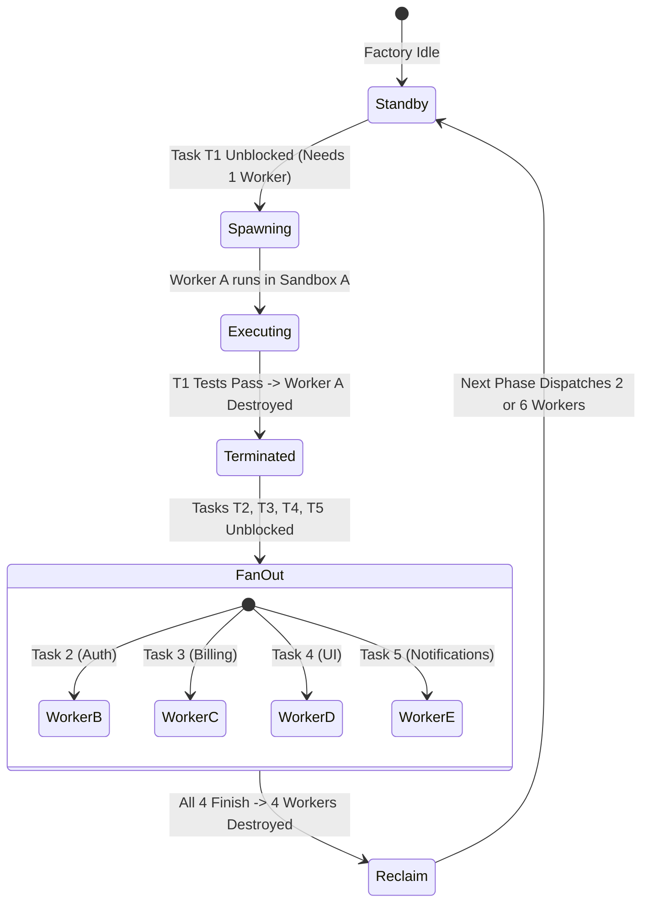
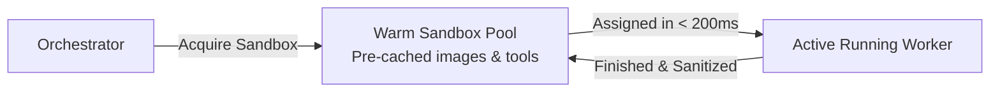

# Ephemeral Worker Lifecycle and Elasticity

In a software factory, **agents are short-lived, disposable execution pods**. They are **not** persistent bots that sit idle waiting for commands.

```
Agent = (Prompt Template + Hydrated Context + Sandbox Tools + LLM API Session)
```

---

## The Dynamic Elasticity Lifecycle

When building complex software, worker demand fluctuates dynamically according to the DAG topology:



1. **Step 1 (Root Phase)**: Task 1 is `READY`. The Orchestrator spins up **1 worker**.
2. **Step 2 (Completion & Teardown)**: Task 1 finishes, commits its code, exports its types, and is **immediately killed**.
3. **Step 3 (Fan-Out)**: Tasks 2, 3, 4, and 5 are now unblocked. The Orchestrator elastically spins up **4 parallel workers**.
4. **Step 4 (Reclamation)**: As each task finishes, its container and context are reclaimed.
5. **Step 5 (Fan-In / Next Phase)**: The next stage may require 6 workers or only 1 integration worker. The factory scales seamlessly without holding idle resources.

---

## Worker Pool Management (Warm vs. Cold Pools)

Spinning up execution environments introduces latency:
- **Cold Starts**: Pulling a Docker image or cloning a repo can take 15–45 seconds.
- **Warm Worker Pool**: The Orchestrator maintains a pool of pre-warmed, idle sandboxes with dependencies (`node_modules`, Maven `.m2` cache) pre-cached.



---

## Detailed Lifecycle Stages of a Single Worker

| Stage | Duration | Action Taken |
| :--- | :--- | :--- |
| **1. Provision** | ~200ms | Orchestrator claims a sandbox container and checks out the task's Git branch. |
| **2. Hydrate** | ~50ms | JIT Prompt Hydrator compiles the prompt with upstream contracts and acceptance criteria. |
| **3. Execute Loop** | 2–10 min | Worker calls LLM, edits files, executes bash, and inspects compiler output. |
| **4. Verify** | 30–60s | Runs automated verification command (`npm test`, `mvn test`). |
| **5. Commit Diff** | ~1s | Creates atomic Git commit on the task branch (`checkpoint/T2`). |
| **6. Teardown** | ~100ms | Sandbox container is destroyed or reset to a clean snapshot. Context tokens are freed. |

---

## Why Ephemeral Workers are Mandatory

1. **Cost Minimization**: You only pay for LLM inference and compute while an agent is actively solving a task.
2. **Zero State Bleed**: Prevents accidental contamination between tasks. Every agent starts with a clean slate and verifiable inputs.
3. **Horizontal Elasticity**: You can run 2 workers on a developer laptop or 200 parallel workers across a Kubernetes cluster.

---

## Related Notes
- [[02-agent-registry-and-blueprints|Agent Registry and Blueprints]]
- [[03-execution-sandboxes-and-isolation|Execution Sandboxes and Isolation]]
- [[02-event-driven-dependency-resolution|Event-Driven Dependency Resolution]]
- [[03-two-tier-hybrid-orchestration|Two-Tier Hybrid Orchestration Pattern]]
