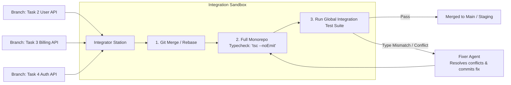

# Execution Sandboxes and Isolation

In an autonomous software factory, **code cannot be validated in the abstract**. An agent generating code without compiling, linting, and running unit tests is just hallucinating syntax.

Furthermore, agents cannot run arbitrary terminal commands directly on the host machine. They require **Isolated Execution Sandboxes**.

---

## The Three Sandbox Architectures

```mermaid
flowchart TD
    subgraph Option1["1. Local Git Worktrees (MVP / Dev)"]
        W1[Host OS Process]
        W2[Isolated git worktree directory]
        W1 --> W2
    end

    subgraph Option2["2. Ephemeral Docker Containers (Self-Hosted Standard)"]
        D1[Docker Daemon / Podman]
        D2[Container: Node / Java / Python + Git]
        D3[Mounted Task Branch]
        D1 --> D2 --> D3
    end

    subgraph Option3["3. Cloud MicroVMs (Enterprise Scale)"]
        M1[E2B / Modal / Fly.io Firecracker VMs]
        M2[Full Linux VM booted in < 200ms]
        M3[Hardware-level virtualization & safety]
        M1 --> M2 --> M3
    end
```



### 1. Local Git Worktrees (Prototyping / Local Dev)
- Uses `git worktree add ../sandboxes/task-2 task-2-branch`.
- Agents run as local processes constrained to that folder.
- **Fast and lightweight**, but lacks process and network isolation.

### 2. Ephemeral Docker Containers (Self-Hosted Production)
- Spun up via the Docker SDK.
- Pre-loaded with required toolchains (JDK 21, Node.js 20, Python 3.12, Gradle).
- Bound to an isolated network with strict egress rules.
- Destroyed or reset upon task completion.

### 3. Cloud MicroVMs (e.g., E2B.dev, Modal) (Production Cloud Standard)
- Hardware-isolated microVMs (powered by Firecracker or QEMU) that boot in 150–300 milliseconds.
- Provides complete kernel-level isolation, safe execution of untrusted package installs, and built-in programmatic SDKs for bash execution and file streaming.

---

## The Self-Correcting Feedback Loop

The greatest strength of an isolated sandbox is enabling the agent to **repair its own mistakes**:

```mermaid
sequenceDiagram
    participant Agent as Worker Agent
    participant Box as Sandbox Execution Runtime
    participant Comp as Compiler / Test Runner

    Agent->>Box: Writes 'src/api/order.ts'
    Agent->>Box: Executes: 'npm test tests/order.test.ts'
    Box->>Comp: Runs test suite
    Comp-->>Box: Exit Code 1: AssertionError: Expected 200, received 400
    Box-->>Agent: Returns stdout / stderr with stack trace
    Note over Agent: Agent analyzes error, identifies missing header validation
    Agent->>Box: Edits 'src/api/order.ts'
    Agent->>Box: Executes: 'npm test tests/order.test.ts'
    Box->>Comp: Runs test suite
    Comp-->>Box: Exit Code 0: All 5 tests passed
    Box-->>Agent: Success confirmation
```

By streaming compiler output, TypeScript diagnostic errors, and test assertions directly back into the agent's turn loop, the factory allows agents to iteratively self-correct without human intervention.

---

## The Automated Integrator Station

Once parallel agents finish their respective tasks in isolated sandboxes, their branches must be merged into the integration branch:



1. **Deterministic Merge**: Automated git merge across disjoint file boundaries.
2. **Global Verification**: Runs end-to-end integration tests across the merged changes.
3. **Automated Conflict Resolution**: If a signature mismatch occurs, a specialized **Fixer Agent** is dispatched with the two conflicting diffs and the compiler error to reconcile them.

---

## Related Notes
- [[01-ephemeral-worker-lifecycle|Ephemeral Worker Lifecycle and Elasticity]]
- [[02-agent-registry-and-blueprints|Agent Registry and Blueprints]]
- [[03-two-tier-hybrid-orchestration|Two-Tier Hybrid Orchestration Pattern]]
- [[01-context-scoping-and-contract-first|Context Scoping and Contract-First Development]]
