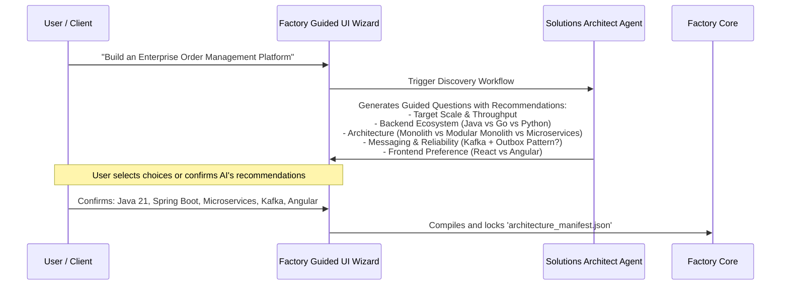

# Guided Architecture Discovery (Phase 0)

When users interact with an AI system, they often start with vague or underspecified prompts:
> *"Build me an enterprise order management platform."*

If the factory immediately starts generating code, the LLM will fall back on its training biases: typically a **Python or Node.js monolith with SQLite**.

If the client required a **Java 21 Microservice architecture with Saga Orchestration, Kafka events, and an Outbox pattern**, the factory has failed catastrophically before writing its first line of code.

To prevent this intent mismatch, the factory enforces **Phase 0: The Guided Architecture Discovery Interview**.

---

## The Solutions Architect Intake Flow

Before generating tasks, the factory spins up a specialized **Architecture Interviewer Agent** that conducts an interactive discovery session:

---

## Reasoned Recommendations (Not Blank Slates)

The interviewer agent does not present an intimidating blank form. It analyzes the user's business domain and provides **reasoned architectural recommendations with trade-offs**:

> **AI Recommendations for Enterprise Order Management:**
> 1. **Architecture Style**:
>    - *(Recommended)* **Modular Monolith**: Fastest time to market, strong transactional integrity, can be split into microservices later.
>    - *Alternative*: **Event-Driven Microservices**: Best if you already have multiple distributed teams requiring independent deployment.
> 2. **Backend Framework**:
>    - *(Recommended)* **Java 21 (Spring Boot 3)**: Best enterprise support for distributed transactions, high throughput, and mature Kafka libraries.
>    - *Alternative*: **Go (gRPC)**: Lower memory footprint, ultra-fast cold starts.
> 3. **Messaging & Consistency**:
>    - *(Recommended)* **Transactional Outbox with Kafka**: Guarantees at-least-once delivery between relational DB commits and message publishing.

---

## Human-in-the-Loop Sign-Off

The user can:
- **Accept** the recommended defaults with one click.
- **Override** specific selections (e.g., *"Switch Angular to React"*, *"Use Go instead of Java"*).
- **Add custom constraints** (e.g., *"Must be deployable on AWS EKS with Helm charts"*).

Once signed off, these decisions are frozen into the `architecture_manifest.json`, which acts as an unbreakable contract for all downstream agents.

---

## Related Notes
- [[02-architecture-manifest-and-adrs|Architecture Manifest and ADRs]]
- [[03-factory-archetypes-and-chassis|Factory Archetypes and Chassis Platforms]]
- [[04-evolutionary-architecture|Evolutionary Architecture: Monolith to Microservices]]
- [[01-agentic-software-factory-paradigm|The Agentic Software Factory Paradigm]]
