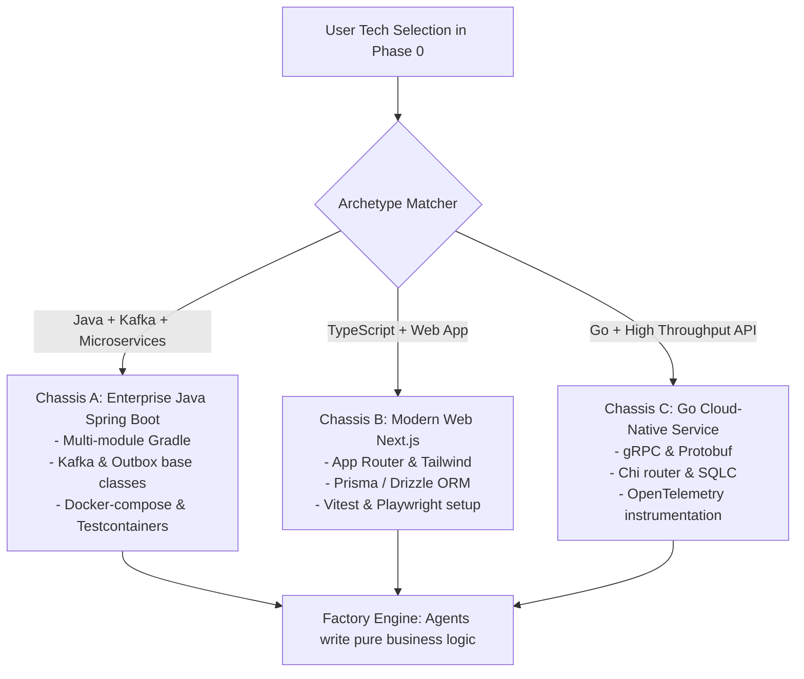

# Factory Archetypes and Chassis Platforms

A common ambition when building a software factory is: **"This engine should be able to build anything."**

However, in software engineering, **unconstrained generation produces chaotic, unmaintainable code**. If an AI agent has to invent the folder structure, build tool configuration, Docker scripts, and base abstractions from scratch on every run, subtle bugs and configuration drifts are guaranteed.

The solution used in modern manufacturing is the **Chassis Platform (Archetype)**.



---

## What is an Architectural Chassis?

An archetype is a pre-engineered, modular foundation containing:
1. **Validated Build Configuration**: Pre-tested `build.gradle`, `pom.xml`, or `package.json` with compatible dependency versions.
2. **Standard Directory Layout**: Domain-Driven Design (DDD) or Clean/Hexagonal Architecture folder structures.
3. **Pre-Written Base Abstractions**:
   - Outbox publisher abstract class.
   - Idempotent event consumer handler.
   - Standardized API error responses (`RFC 7807 Problem Details`).
4. **Integration Test Infrastructure**: Pre-configured `docker-compose.yml` or Testcontainers to spin up databases and message queues during sandbox testing.

---

## Directory Layout of Factory Archetypes

Inside the factory core engine repository:

```
factory-engine/
└── archetypes/
    ├── java-spring-microservices/
    │   ├── template/
    │   │   ├── build.gradle.kts
    │   │   ├── settings.gradle.kts
    │   │   ├── docker-compose.infra.yml
    │   │   └── common-outbox/
    │   └── metadata.json
    ├── nextjs-fullstack/
    │   ├── template/
    │   │   ├── package.json
    │   │   ├── tsconfig.json
    │   │   └── tailwind.config.ts
    │   └── metadata.json
    └── go-grpc-service/
        ├── template/
        │   ├── go.mod
        │   ├── Makefile
        │   └── proto/
        └── metadata.json
```

---

## How the Factory Uses Archetypes

1. **Phase 0 Confirmation**: The user confirms: *"Java 21, Spring Boot 3, Apache Kafka, Microservices"*.
2. **Chassis Instantiation**: The Orchestrator copies the `java-spring-microservices` template into the target repository.
3. **Deterministic Build Verification**: The Orchestrator runs `./gradlew build` inside a sandbox. The baseline template passes with exit code 0.
4. **Task Scoping for Agents**: Coder Agents are **not** tasked with configuring Gradle plugins or setting up Kafka connection factories. They are assigned focused business domain tasks:
   > *"Implement the `OrderEntity` and `createOrder()` domain service using the pre-existing `AbstractOutboxPublisher`."*

This dramatically reduces token usage, speeds up build times, and eliminates configuration hallucinations.

---

## Related Notes
- [[01-guided-architecture-discovery|Guided Architecture Discovery (Phase 0)]]
- [[02-architecture-manifest-and-adrs|Architecture Manifest and ADRs]]
- [[04-evolutionary-architecture|Evolutionary Architecture: Monolith to Microservices]]
- [[01-what-is-a-software-factory|What is a Software Factory?]]
