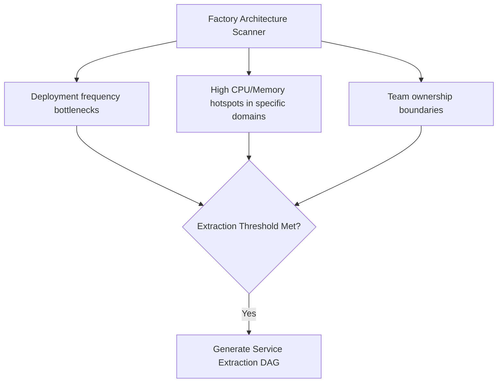
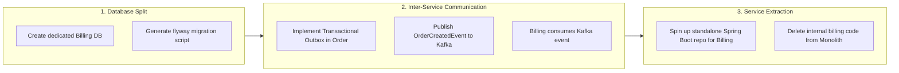

# Evolutionary Architecture: Monolith to Microservices

A central question in enterprise design is: **"Can the software factory decide or evolve the architecture over time—shifting from a monolith to microservices?"**

In modern software engineering, starting directly with 20 microservices for a new product is one of the most common causes of distributed failure (network latencies, distributed transaction failures, complex debugging).

The industry-proven strategy is **Evolutionary Architecture**:
$$\text{Clean Monolith} \xrightarrow{\text{Formalize Modules}} \text{Modular Monolith} \xrightarrow{\text{Extract Domains}} \text{Event-Driven Microservices}$$

The software factory can support and automate this entire evolutionary lifecycle.

---

## Phase 1: The Modular Monolith (The Foundation)

When a project starts, the factory enforces **Domain-Driven Design (DDD)** inside a single codebase.

```
src/main/java/com/enterprise/
├── order/                 # Bounded Context A
│   ├── domain/
│   ├── api/
│   └── internal/
├── billing/               # Bounded Context B
│   ├── domain/
│   ├── api/
│   └── internal/
└── inventory/             # Bounded Context C
    ├── domain/
    ├── api/
    └── internal/
```

### Architectural Enforcement:
- The `order` module may **only** call public interfaces exposed in `billing/api`.
- Direct access to `billing/internal` or direct SQL joins across billing tables are strictly prohibited by **ArchUnit tests** in the sandbox.

---

## Phase 2: Detecting the Need for Extraction

As the enterprise grows, an **Architecture Analyzer Agent** periodically scans the repository during maintenance runs:



When a domain (e.g., `billing`) reaches high throughput or independent deployment needs, the factory triggers the **Microservice Extraction Pipeline**.

---

## Phase 3: The Automated Service Extraction DAG

The Orchestrator generates a **Refactoring DAG** to decouple the module without breaking system functionality:



---

## Distributed Consistency: Sagas & Outbox

When the factory transitions from a monolith to microservices, traditional single-database ACID transactions are no longer possible. The factory implements two essential patterns:

### 1. The Transactional Outbox Pattern
Avoids dual-write inconsistency when updating a database and publishing a Kafka event:
```
+-------------------------------------------------------------+
| Single Database Transaction                                 |
|                                                             |
| 1. INSERT INTO orders (id, user_id, amount) VALUES (...);  |
| 2. INSERT INTO outbox_events (topic, payload) VALUES (...); |
+-------------------------------------------------------------+
                           |
                           v (Change Data Capture / Debezium)
                    [Apache Kafka]
```

### 2. Saga Orchestration Pattern
For workflows spanning multiple microservices (e.g., Create Order $\to$ Reserve Inventory $\to$ Charge Payment):
- An **Orchestration Service** (or State Machine) coordinates each step.
- If payment fails, the orchestrator triggers **compensating transactions** (e.g., `ReleaseInventoryEvent`) to maintain eventual consistency.

---

## Key Takeaway

A mature software factory does not treat architecture as a static one-time choice. By starting with strict modular boundaries in a **Modular Monolith**, the factory preserves the option to cleanly carve out microservices with automated refactoring DAGs whenever business scale demands it.

---

## Related Notes
- [[01-guided-architecture-discovery|Guided Architecture Discovery (Phase 0)]]
- [[02-architecture-manifest-and-adrs|Architecture Manifest and ADRs]]
- [[03-factory-archetypes-and-chassis|Factory Archetypes and Chassis Platforms]]
- [[03-dynamic-dag-mutation-and-blast-radius|Dynamic DAG Mutation and Blast Radius Analysis]]
