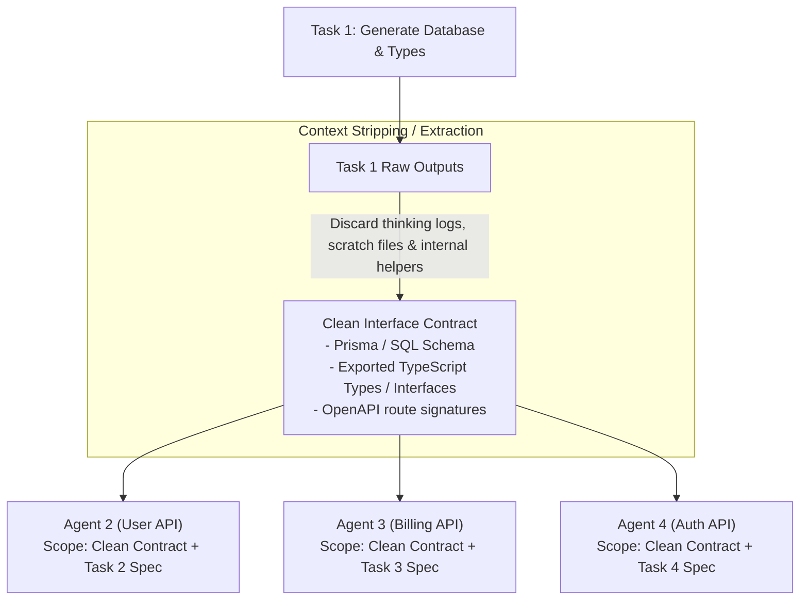

# Context Scoping and Contract-First Development

One of the quickest ways to degrade agent performance in an autonomous software factory is **context bloat**.

When an agent is fed the entire repository history, all conversation logs, and all raw source code files, three things happen:
1. **Reasoning Collapses**: LLMs suffer from the "lost in the middle" phenomenon and begin ignoring crucial instructions.
2. **Hallucinations & Conflicting Patterns Multiply**: The agent blends conflicting patterns from different parts of the repo.
3. **Token Inefficiency**: Running 100,000 tokens through multi-turn agent loops costs significant time and money.

The solution is **Context Scoping** combined with **Contract-First Development**.

---

## The Contract-First Principle

When 4 tasks depend on Task 1, **never pass Task 1's full internal implementation code or thinking logs** to Tasks 2, 3, 4, and 5.

Instead, extract and pass only the **Interface Contract**:



> [!TIP] The Contractor Analogy
> Treat each worker agent like an external specialist contractor. You do not hand a contractor your company's entire 10-year email archive; you give them the architectural blueprint, the exact API interface they must build against, their file boundaries, and acceptance criteria.

---

## The Three Layers of an Agent Context Payload

A well-scoped context payload rarely exceeds 5,000–8,000 tokens:

```
+-----------------------------------------------------------+
| 1. GLOBAL RULESET (~500 tokens)                           |
| - Coding conventions, linter rules, formatting guidelines  |
+-----------------------------------------------------------+
| 2. DIRECT DEPENDENCY CONTRACTS (~1,500 - 3,000 tokens)   |
| - Types, interfaces, DB models, and API schemas from     |
|   upstream dependencies                                   |
+-----------------------------------------------------------+
| 3. TASK-SPECIFIC SCOPE (~1,000 - 2,000 tokens)            |
| - Clear goal and acceptance criteria (Gherkin/test specs)  |
| - Explicit list of writable files vs read-only files      |
+-----------------------------------------------------------+
```

---

## File & Module Ownership Partitioning

To enable safe parallel development without merge conflicts, the factory enforces **strict file boundaries**:

```
Task 2 (User API)     owns: src/api/users/**, tests/api/users/**
Task 3 (Billing API)  owns: src/api/billing/**, tests/api/billing/**
Task 4 (Auth API)     owns: src/api/auth/**, tests/api/auth/**
```

If an agent attempts to edit a shared file (e.g., `src/utils/shared_helpers.ts`), the tool execution is intercepted and rejected by the sandbox engine:

```text
[Sandbox Security Intercept]: Permission Denied.
You are attempting to modify 'src/utils/shared_helpers.ts'.
This file is outside your assigned file_system_scope.writable_files.
Keep your helper methods private to your module or request a contract update.
```

---

## Related Notes
- [[02-just-in-time-prompt-hydration|Just-In-Time (JIT) Prompt Hydration]]
- [[03-codebase-intelligence-layer|Codebase Intelligence Layer and Shared Memory]]
- [[01-dag-specification-and-generation|DAG Specification and Generation]]
- [[03-execution-sandboxes-and-isolation|Execution Sandboxes and Isolation]]
