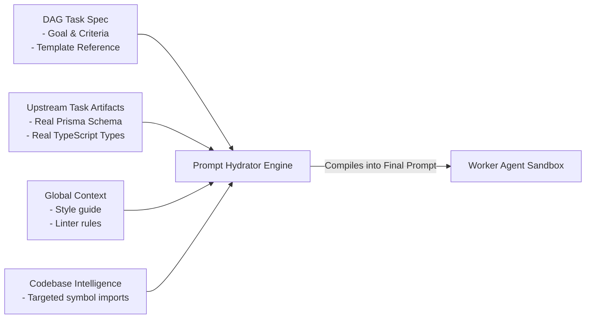

# Just-In-Time (JIT) Prompt Hydration

A common design question is: **"Should the DAG store the final prompt for each agent?"**

> [!WARNING] Architecture Anti-Pattern
> **Storing final raw prompt strings statically in the DAG is an anti-pattern.**
> When the DAG is created on Day 1, Task 1 has not executed yet. You do not know what database table names Task 1 will generate, what TypeScript types it will export, or what Git commit hash it will produce.

Instead, the DAG stores a **Prompt Specification (The Recipe)**, and the Orchestrator's **Prompt Hydrator** compiles the final prompt **Just-In-Time (JIT)** right before dispatching the agent.

---

## The Prompt Hydration Engine Architecture



---

## The Blueprint: Jinja2 Prompt Template

The factory maintains reusable Jinja2 templates in an `agents/templates/` directory:

```jinja2
{# templates/backend_worker.jinja2 #}
You are a {{ agent_role }} working on the enterprise software factory assembly line.

## MISSION
{{ task.goal }}

## STRICT CONTRACTS & INTERFACES (From Upstream Dependencies)
The following contracts have already been compiled and verified by upstream tasks.
You MUST import and adhere to them without breaking changes:

### {{ artifact.artifact_type }} (from Task: {{ artifact.from_task }})
```{{ artifact.language }}
{{ artifact.content }}
```


## FILE BOUNDARIES
- You may ONLY modify files in: {{ task.file_system_scope.writable_files }}
- Read-only reference files: {{ task.file_system_scope.read_only_files }}

## ACCEPTANCE CRITERIA

- [ ] {{ criterion }}


## VERIFICATION COMMAND
Before signaling completion, you MUST run:
`{{ task.verification_command }}`
All tests must pass with exit code 0.
```

---

## Example: Hydrated Final Prompt

When Task 1 (`T1_db_schema`) finishes, it produces concrete artifacts. Right before Task 2 (`T2_stripe_webhook`) runs, the Prompt Hydrator renders the final prompt:

```markdown
You are a BACKEND_CODER working on the enterprise software factory assembly line.

## MISSION
Implement Stripe webhook handler to fulfill customer orders.

## STRICT CONTRACTS & INTERFACES (From Upstream Dependencies)
The following contracts have already been compiled and verified by upstream tasks.
You MUST import and adhere to them without breaking changes:

### EXPORTED_TYPES (from Task: T1_db_schema)
```typescript
export interface Order {
  id: string;
  userId: string;
  amountCents: number;
  currency: string;
  status: "PENDING" | "PAID" | "FAILED";
  createdAt: Date;
}

export type WebhookEventPayload = {
  id: string;
  type: string;
  data: { object: Record<string, unknown> };
};
```

## FILE BOUNDARIES
- You may ONLY modify files in: ['src/api/webhooks/stripe.ts', 'tests/webhooks/stripe.test.ts']
- Read-only reference files: ['prisma/schema.prisma', 'src/types/billing.d.ts']

## ACCEPTANCE CRITERIA
- [ ] Verify Stripe HMAC signature using STRIPE_WEBHOOK_SECRET
- [ ] Handle checkout.session.completed event idempotently
- [ ] Update database order status to 'PAID'
- [ ] Return HTTP 200 for valid events and HTTP 400 for bad signatures

## VERIFICATION COMMAND
Before signaling completion, you MUST run:
`npm test tests/webhooks/stripe.test.ts`
All tests must pass with exit code 0.
```

---

## Key Benefits of JIT Hydration

1. **Ground Truth Accuracy**: Prompts always reflect the *actual* code produced by preceding tasks, never speculative guesses.
2. **Template Maintainability**: Changing a global system rule or prompt instruction updates every future task without needing to regenerate the DAG.
3. **Token Efficiency**: Upstream artifacts are stripped to their minimal interface definitions before injection.

---

## Related Notes
- [[01-context-scoping-and-contract-first|Context Scoping and Contract-First Development]]
- [[01-dag-specification-and-generation|DAG Specification and Generation]]
- [[02-agent-registry-and-blueprints|Agent Registry and Blueprints]]
- [[03-codebase-intelligence-layer|Codebase Intelligence Layer and Shared Memory]]
