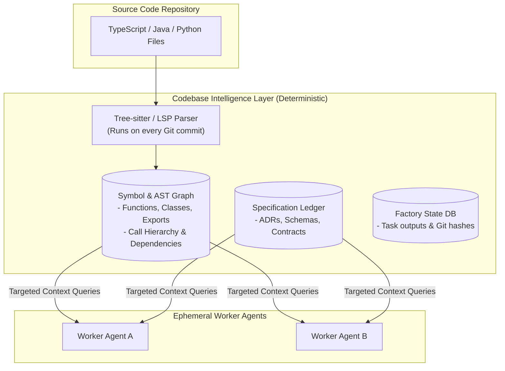

# Codebase Intelligence Layer and Shared Memory

When designing an autonomous software factory, a common architectural question is: **"Does the factory need a single central brain that holds the entire knowledge graph?"**

We must distinguish between an anti-pattern and a necessary infrastructure component:

| Concept | What It Means | Recommendation |
| :--- | :--- | :--- |
| **"God Agent" (One Massive LLM)** | A single long-running LLM session trying to remember the whole repo in its context. | ❌ **Anti-Pattern**: Memory degrades, costs explode, context overflows. |
| **"Codebase Intelligence Layer"** | A centralized data store (AST, Symbol Graph, SQLite, Vector Index) queried on demand. | ✅ **Essential Infrastructure**: Gives short-lived agents accurate ground truth. |

---

## Architecture of the Codebase Intelligence Layer

Rather than an AI agent sitting in memory forever, the factory maintains a **deterministic, indexable intelligence layer**:



---

## Subsystems of the Intelligence Layer

### 1. The AST & Symbol Graph (Tree-sitter / Language Server Protocol)
Instead of embedding raw text, the engine parses files into an **Abstract Syntax Tree (AST)** using tools like **tree-sitter**:
- Tracks every `class`, `interface`, `function`, and `exported variable`.
- Maps dependencies: *File A imports `OrderModel` from File B*.
- When an agent asks: *"What does `calculateTax()` look like?"*, the engine fetches only that 15-line function signature, not the entire 1,000-line file.

### 2. The Specification Ledger
A version-controlled directory (e.g., `.factory/specs/`) storing machine-readable contracts:
- `architecture_manifest.json`: Invariant tech stack rules.
- `schema.prisma` / `schema.sql`: Authoritative database schemas.
- `openapi.yaml`: REST API route contracts.

### 3. The Execution Ledger (State Database)
A PostgreSQL or SQLite database maintained by the Orchestrator storing:
- Completed task IDs, runtimes, and exit statuses.
- Exact Git commit hashes for every milestone.
- Failure logs and compiler outputs for post-mortem analysis.

---

## How Ephemeral Agents Interact with the Intelligence Layer

Worker agents have access to specialized read-only tools that query the Intelligence Layer rather than grepping through millions of lines of code:

```python
# Tool available to worker agents inside their sandbox
def query_symbol(symbol_name: str) -> dict:
    """
    Looks up a function, type, or class in the repository symbol graph
    and returns its definition, signature, and containing file path.
    """
    return symbol_db.find_symbol(symbol_name)

def get_contract(contract_name: str) -> str:
    """
    Fetches the authoritative schema or interface definition 
    from the Specification Ledger.
    """
    return spec_ledger.get(contract_name)
```

By decoupling **knowledge storage (deterministic databases)** from **reasoning (ephemeral LLM workers)**, the factory scales to codebases of millions of lines of code with zero context degradation.

---

## Related Notes
- [[01-context-scoping-and-contract-first|Context Scoping and Contract-First Development]]
- [[02-just-in-time-prompt-hydration|Just-In-Time (JIT) Prompt Hydration]]
- [[02-deterministic-macro-orchestrator|Deterministic Macro-Orchestrator Architecture]]
- [[01-ephemeral-worker-lifecycle|Ephemeral Worker Lifecycle and Elasticity]]
