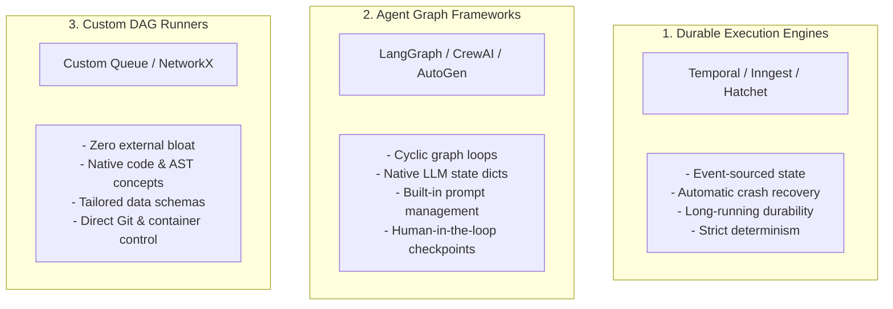

# Orchestration Frameworks Comparison

When designing an autonomous software factory, choosing the right runtime engine to coordinate agents and tasks is a critical architectural decision. Naive implementations relying on simple loops or basic scripts break down rapidly under concurrency, server restarts, and long-running operations.

---

## Why Simple Scripts and Loops Fail

Attempting to run an agentic software factory using basic `while` loops or async scripts exposes major systemic flaws:
1. **Server Restarts Wipe Out Progress**: An LLM-driven build or refactor can take 30 to 90 minutes. If the host process crashes or restarts, all in-memory state is lost.
2. **Infinite Loops and Token Burn**: When an agent gets trapped in a circular compilation error, an unconstrained loop will burn thousands of dollars in LLM API tokens.
3. **Lack of Durable Pauses**: If a workflow requires human approval on an architectural blueprint, the process cannot block a thread for days in memory.
4. **Unhandled Concurrency & Deadlocks**: Managing dependencies across 10 parallel agents writing code requires formal DAG scheduling and atomic state persistence.

---

## The Three Primary Architectural Options

---

### 1. Durable Workflow Engines (e.g., Temporal, Inngest, Hatchet)

Durable execution engines are industrial-grade platforms created by distributed systems engineers. They guarantee that code runs to completion regardless of hardware failures, network timeouts, or multi-day pauses.

#### Strengths:
- **Crash Durability**: Every state transition and activity result is recorded in an event log (backed by Postgres or Cassandra). If a worker node crashes mid-task, another worker resumes at the exact line of code.
- **Durable Timers and Pauses**: Can pause a workflow for 3 days waiting for human PR approval with zero memory overhead.
- **Enterprise Scalability**: Handles thousands of concurrent activities with native retries, exponential backoffs, and rate-limiting.

#### Weaknesses:
- Steep learning curve requiring understanding of event sourcing, activity workers, and workflow determinism rules.
- Heavy infrastructure footprint (requires dedicated Temporal cluster or managed cloud).

---

### 2. LLM / Agent Graph Frameworks (e.g., LangGraph, CrewAI, AutoGen)

These frameworks are specifically built around the nature of LLM reasoning loops, message passing, and multi-agent conversations.

#### Strengths:
- **Native Support for Cycles**: Traditional workflows are acyclic ($A \to B \to C$). Agent development is fundamentally cyclic ($Coder \to Tester \to Error \to Coder$).
- **State Management**: Built-in state schemas and message history trimming.
- **Rapid Prototyping**: Fast setup for conversational agent handoffs and tool calling.

#### Weaknesses:
- Heavy abstraction layers make debugging difficult when prompt formatting or internal schemas change.
- Lower crash resilience compared to distributed systems engines unless paired with persistent checkpointers.

---

### 3. Custom DAG Runners (e.g., Python NetworkX + Celery / BullMQ)

A custom-built DAG execution engine designed specifically around software engineering concepts (Git branches, AST nodes, compiler outputs).

#### Strengths:
- **Zero Bloat & Complete Control**: Designed strictly for your schema; no unnecessary abstractions.
- **Domain-Specific Logic**: Deep integration with Git worktrees, Docker container pools, and compiler error parsers.

#### Weaknesses:
- You must build and maintain your own state persistence, retries, deadlocks detection, and concurrency throttles.

---

## Detailed Comparison Matrix

| Feature | Temporal / Inngest | LangGraph / AutoGen | Custom DAG Runner |
| :--- | :--- | :--- | :--- |
| **Crash Durability** | **100% Guaranteed** (Event Sourcing) | Moderate (Relies on checkpointer) | Depends on implementation |
| **Cyclic Loops Support** | Via activity iteration | **Native & Intuitive** | Custom loop logic |
| **Long-Running Pauses (Days)** | **Native** (Zero cost when paused) | Requires persistent store | Custom database polling |
| **Parallel Execution** | Native & highly robust | Graph-based branching | Task queue worker pool |
| **Ecosystem Coupling** | Low (Language SDK agnostic) | High (Tightly coupled to framework) | None (Your proprietary code) |
| **Best Used For** | Production-grade macro workflows | Micro reasoning & critique loops | Tailored internal engine builds |

---

## Related Notes
- [[02-deterministic-macro-orchestrator|Deterministic Macro-Orchestrator Architecture]]
- [[03-two-tier-hybrid-orchestration|Two-Tier Hybrid Orchestration Pattern]]
- [[01-dag-specification-and-generation|DAG Specification and Generation]]
