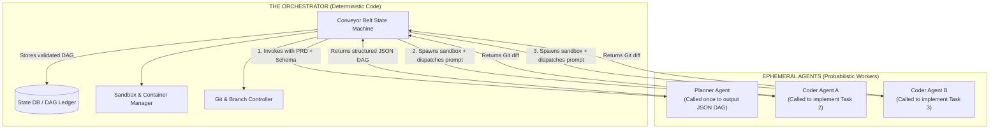

# Deterministic Macro-Orchestrator Architecture

> [!CAUTION] The Fundamental Rule of Factory Architecture
> **The Macro-Orchestrator MUST be deterministic code, NOT an AI agent.**

One of the most common pitfalls when designing an agentic system is attempting to let an LLM act as the central orchestrator (e.g., asking an LLM: *"You are the manager. Look at the database and decide which task to run next"*). 

This approach consistently fails at production scale.

---

## Why an LLM Cannot Be the Macro-Orchestrator

1. **Non-Deterministic Transitions**: An LLM might randomly decide to skip Task 3 because *"Task 4 looks more exciting"*, or repeat Task 1 because it lost confidence in its memory.
2. **Hallucinated State Changes**: When a test fails in the sandbox, an LLM might declare the task `COMPLETED` anyway due to polite or optimistic alignment tendencies.
3. **Catastrophic Inefficiency**: Keeping a large LLM awake 24/7 simply to evaluate whether `Task 1 == DONE` wastes massive amounts of money and computational resources.
4. **Lack of Mathematical Rigor**: Determining whether all dependencies in a Directed Acyclic Graph are satisfied is an exact topological graph problem (`Set(Dependencies) ⊆ Set(CompletedTasks)`). It is solved with 3 lines of boolean code, not probabilistic token prediction.

---

## The Correct Division of Responsibilities



### The Orchestrator (The Conveyor Belt)
- Written in TypeScript, Python, or Go.
- Maintains the authoritative state machine.
- Manages concurrency, rate-limits, and worker pools.
- Executes Git operations, merges, and container provisioning.
- Evaluates exit codes from compilers and test runners deterministically.

### The Agents (The Assembly Workers)
- Ephemeral API calls to LLM reasoning models.
- Invoked with specific, bounded context.
- Execute tools inside sandboxes.
- Terminated as soon as their assigned task passes verification.

---

## The State Database Schema

A minimal database schema for tracking the factory state deterministically in PostgreSQL or SQLite:

```sql
-- The Task Graph State Table
CREATE TABLE tasks (
    id VARCHAR(64) PRIMARY KEY,
    project_id VARCHAR(64) NOT NULL,
    name VARCHAR(255) NOT NULL,
    status VARCHAR(32) NOT NULL CHECK (
        status IN ('PENDING', 'RUNNING', 'COMPLETED', 'STALE', 'FAILED', 'CANCELLED')
    ),
    required_role VARCHAR(64) NOT NULL, -- e.g. 'BACKEND_CODER', 'FRONTEND_CODER'
    dependencies JSONB NOT NULL DEFAULT '[]', -- Array of parent task IDs
    target_files JSONB NOT NULL DEFAULT '[]',
    git_branch VARCHAR(128),
    git_checkpoint_hash VARCHAR(40),
    retry_count INT DEFAULT 0,
    created_at TIMESTAMP WITH TIME ZONE DEFAULT NOW(),
    updated_at TIMESTAMP WITH TIME ZONE DEFAULT NOW()
);

-- Artifacts produced by completed tasks
CREATE TABLE task_artifacts (
    id SERIAL PRIMARY KEY,
    task_id VARCHAR(64) REFERENCES tasks(id),
    artifact_type VARCHAR(64) NOT NULL, -- 'EXPORTED_TYPES', 'PRISMA_SCHEMA', 'OPENAPI_SPEC'
    content TEXT NOT NULL,
    created_at TIMESTAMP WITH TIME ZONE DEFAULT NOW()
);
```

---

## Related Notes
- [[01-orchestration-frameworks-comparison|Orchestration Frameworks Comparison]]
- [[03-two-tier-hybrid-orchestration|Two-Tier Hybrid Orchestration Pattern]]
- [[02-event-driven-dependency-resolution|Event-Driven Dependency Resolution]]
- [[01-ephemeral-worker-lifecycle|Ephemeral Worker Lifecycle and Elasticity]]
