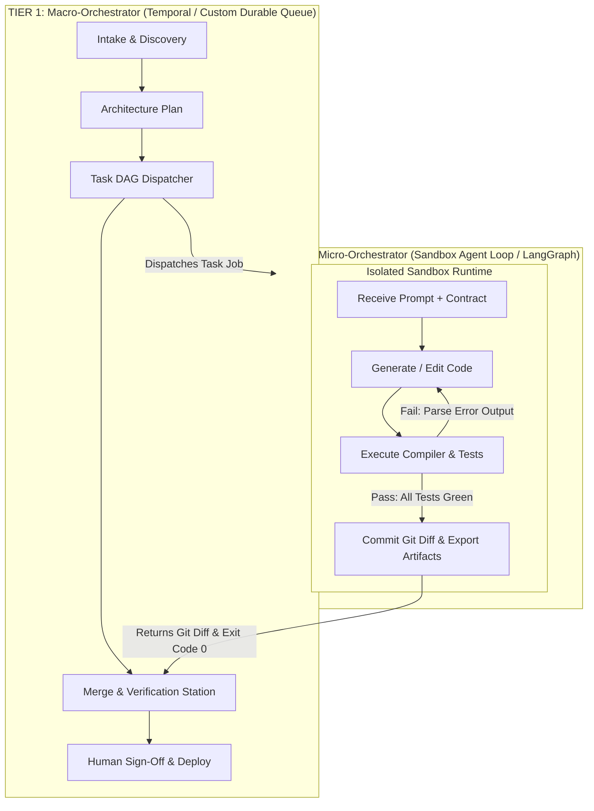

# Two-Tier Hybrid Orchestration Pattern

In high-scale enterprise software factories, trying to use a single tool for both long-running system persistence and rapid agent reasoning loops creates severe friction.

The industry-standard solution is the **Two-Tier Hybrid Architecture**:

---

## Tier 1: The Macro-Orchestrator (Slow, Durable, Transactional)

The Macro-Orchestrator manages the **entire lifecycle of a software project or feature request**. It deals with hours, days, and cross-system transactions.

### Key Characteristics:
- **Durable & Fault-Tolerant**: Backed by Temporal, Inngest, or a PostgreSQL state machine.
- **Acyclic Progression**: Moves the project forward through major milestones (Planning $\to$ Architecture $\to$ Execution $\to$ Review $\to$ Release).
- **Resource Orchestration**: Dispatches jobs, provisions Docker containers, manages Git branches, and requests human approvals.
- **Never Inspects Internal Prompts**: The macro-orchestrator does not care *how* an agent thinks; it only checks whether the activity exited with code `0` or code `1`.

---

## Tier 2: The Micro-Orchestrator (Fast, Cyclic, Local)

The Micro-Orchestrator is the **tight internal reasoning loop of a single worker agent** running inside an isolated sandbox.

### Key Characteristics:
- **Cyclic & Conversational**: Built using LangGraph or custom tool-calling loops (`LLM -> Tool -> Parse -> LLM`).
- **Short-Lived (Minutes)**: Starts when a task is dispatched; terminates as soon as tests pass or max iterations are reached.
- **Error-Driven Self-Correction**: When a unit test or compiler error occurs, it feeds the stderr back into the agent context:
  $$\text{Code} \xrightarrow{\text{Run}} \text{Error} \xrightarrow{\text{Feed Stderr}} \text{Refined Code} \xrightarrow{\text{Verify}} \text{Pass}$$
- **Zero Impact on Macro State**: If an agent fails internally 4 times before fixing its code on the 5th attempt, the Macro-Orchestrator only sees the eventual success.

---

## Comparison of the Two Tiers

| Attribute | Tier 1: Macro-Orchestrator | Tier 2: Micro-Orchestrator |
| :--- | :--- | :--- |
| **Scope** | Entire software repository / project | Single subtask or file domain |
| **Duration** | Hours to weeks | 2 to 15 minutes |
| **Graph Nature** | Directed Acyclic Graph (DAG) | Cyclic Graph (Feedback loops) |
| **State Storage** | Relational DB / Event Sourcing | Local memory / In-container state |
| **Engine Tech** | Temporal, Inngest, Custom Python/Node | LangGraph, Custom ReAct agent loop |
| **Recovery Strategy** | Replay from persistent database | Retry task from clean git checkout |

---

## Why This Architecture Wins

1. **Separation of Concerns**: Prevents the macro workflow from becoming polluted with thousands of transient tool calls and compiler tracebacks.
2. **Crash Resilience**: If a worker container crashes during an agent loop, the Macro-Orchestrator simply retries the activity in a fresh container without restarting the entire project.
3. **Cost & Context Control**: Keeps context windows tightly scoped to the immediate subtask, preventing memory degradation and runaway token bills.

---

## Related Notes
- [[01-orchestration-frameworks-comparison|Orchestration Frameworks Comparison]]
- [[02-deterministic-macro-orchestrator|Deterministic Macro-Orchestrator Architecture]]
- [[01-ephemeral-worker-lifecycle|Ephemeral Worker Lifecycle and Elasticity]]
- [[03-execution-sandboxes-and-isolation|Execution Sandboxes and Isolation]]
