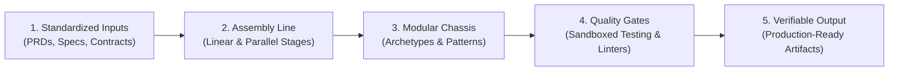

# What is a Software Factory?

A **Software Factory** is an operational model that applies the proven principles of industrial manufacturing to software development. Rather than treating software engineering as an artisan, hand-crafted pursuit where individual developers invent workflows and tooling from scratch for every project, a software factory standardizes, modularizes, and automates the production pipeline.

> [!NOTE] Historical Origin
> The concept of the software factory traces back to **Hitachi in 1969**, which established the first designated Software Works to bring process control to software delivery. It was later popularized in the 2000s by Jack Greenfield and Keith Short at **Microsoft** through software factories based on Domain-Specific Languages (DSLs), reusable patterns, and extensible IDE templates.

---

## The Artisan Workshop vs. The Industrial Factory

To understand the value of a software factory, consider how manufacturing evolved from artisan workshops to modern assembly lines:

| Dimension | Artisan Workshop (Traditional Coding) | Industrial Software Factory |
| :--- | :--- | :--- |
| **Workflow** | Ad-hoc, dependent on individual programmer memory | Standardized, stage-gated assembly line |
| **Component Reuse** | Copy-pasting snippets, disparate libraries | Pre-validated component libraries & architectural chassis |
| **Quality Verification** | Manual testing, inconsistent local verification | Automated sandboxes, continuous verification loops |
| **Output Predictability** | High variance in delivery time and quality | Predictable throughput, measurable quality gates |
| **Knowledge Transfer** | Siloed inside human brains, lost on departure | Codified in machine-readable manifests and schemas |

---

## Core Pillars of a Software Factory

A software factory is built on five core pillars:

### 1. Standardized Inputs
Artisans can work with vague, conversational instructions. A factory requires precise, structured inputs:
- Machine-readable Product Requirement Documents (PRDs).
- Typed interface specifications (OpenAPI, GraphQL, TypeScript interfaces).
- Explicit acceptance criteria (e.g., Gherkin syntax or executable test assertions).

### 2. The Assembly Line
Work is divided into discrete, ordered phases. Work does not advance to the next station until the current station meets its exit criteria.

### 3. Modular Archetypes (Chassis Platforms)
A car factory does not forge new sheet metal shapes from scratch for every vehicle; it uses a shared vehicle chassis. Similarly, a software factory relies on pre-architected **archetypes** (e.g., Enterprise Java + Spring + Kafka, or TypeScript + Next.js).

### 4. Continuous Quality Gates
Quality is not an afterthought checked only before release. Every station runs automated linters, compilers, type-checkers, and unit tests inside isolated execution environments.

### 5. Repeatability & Auditing
Every run produces an auditable ledger: git commits, test coverage reports, execution transcripts, and architectural decision records.

---

## Next Evolutionary Step

With the advent of autonomous Large Language Model (LLM) agents, the software factory concept is experiencing a massive paradigm shift. Instead of human workers manually advancing tasks along the assembly line, autonomous AI agents operate the workstations.

See: [[02-agentic-software-factory-paradigm|The Agentic Software Factory Paradigm]]
