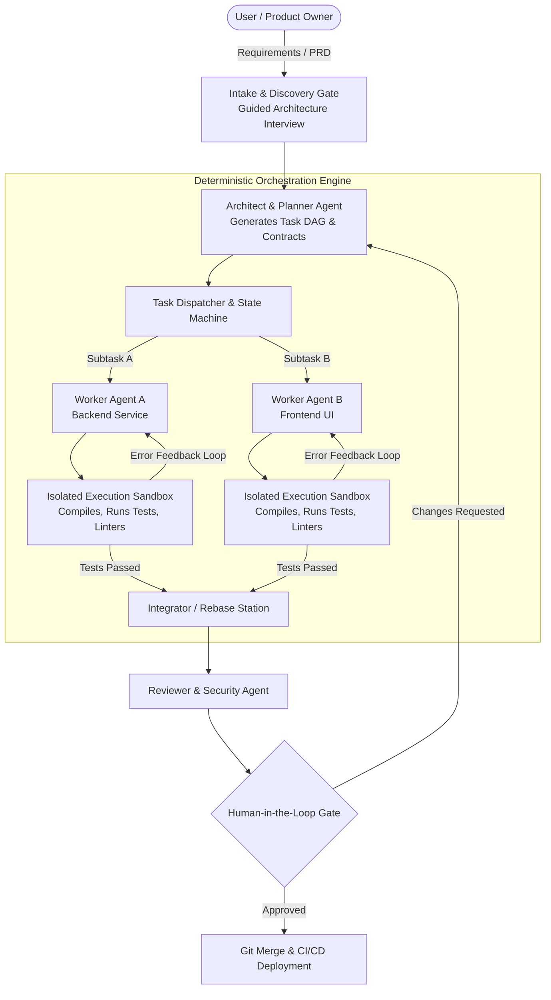

# The Agentic Software Factory Paradigm

An **Agentic Software Factory** is a modern software manufacturing engine where the assembly line workstations are staffed by **autonomous, specialized AI agents**, orchestrated by a **deterministic control plane**.

Rather than using an AI assistant as a simple autocomplete tool or chat interface, an agentic software factory delegates end-to-end tasks (from requirements parsing to code generation, compilation, automated testing, and git pull requests) to coordinated agents.



---

## The Five Core Subsystems

To operate reliably at enterprise scale, an agentic software factory comprises five distinct subsystems:

### 1. The Orchestration Plane (The Control Room)
The central nervous system that coordinates all activities. It tracks task states, evaluates dependencies, dispatches work, manages concurrency, and handles retries.
> [!IMPORTANT]
> The macro-orchestrator is built as **deterministic software code** (e.g., using state machines or durable workflow engines), **not** an unpredictable LLM agent. See [[02-deterministic-macro-orchestrator|Deterministic Macro-Orchestrator Architecture]].

### 2. Specialized Ephemeral Agents (The Workstations)
Instead of a single "generalist" model trying to do everything, the factory employs role-specialized personas:
- **Architect / Planner Agent**: Decomposes specs into Directed Acyclic Graphs (DAGs).
- **Backend Developer Agent**: Implements domain logic, schemas, and routes.
- **Frontend Developer Agent**: Builds UI components and client state stores.
- **QA & Test Agent**: Writes unit, integration, and end-to-end tests.
- **Fixer / Integrator Agent**: Resolves merge conflicts and compiler errors.
- **Security & Compliance Agent**: Audits diffs for OWASP vulnerabilities and credential leaks.

### 3. Isolated Execution Sandboxes (The Test Bench)
Code produced by LLMs cannot be trusted blindly. Every agent operates inside an isolated sandbox (Docker containers, Firecracker microVMs, or local Git worktrees) where code is compiled, dependencies are installed, and test suites are executed in real time.
See: [[03-execution-sandboxes-and-isolation|Execution Sandboxes and Isolation]].

### 4. Codebase Intelligence & Shared Memory (The Blueprint Library)
Agents are short-lived and stateless. They query a centralized repository intelligence layer consisting of Abstract Syntax Trees (ASTs), symbol tables, OpenAPI definitions, and architectural manifests.
See: [[03-codebase-intelligence-layer|Codebase Intelligence Layer and Shared Memory]].

### 5. Human-in-the-Loop (HITL) Gateways
Humans do not spend their days writing repetitive boilerplate. Instead, human engineers act as **Directors and Chief Architects**:
- Setting high-level business goals and constraints.
- Approving architectural decisions and trade-offs.
- Reviewing pull requests and authorizing production deployments.

---

## The Paradigm Shift in Engineering Roles

```
Traditional:  [Human: Types syntax]  --> [Compiler] --> [Tests]
Agentic:      [Human: Evaluates architecture] --> [Agents: Write, Test, Iterate] --> [Human: Reviews PR]
```

In this paradigm, human leverage increases by an order of magnitude. A single engineer can manage a swarm of agents building an entire microservice fleet, provided the orchestration rules and verification gates are strict and deterministic.

---

## Related Notes
- [[01-what-is-a-software-factory|What is a Software Factory?]]
- [[01-orchestration-frameworks-comparison|Orchestration Frameworks Comparison]]
- [[02-deterministic-macro-orchestrator|Deterministic Macro-Orchestrator Architecture]]
- [[01-ephemeral-worker-lifecycle|Ephemeral Worker Lifecycle and Elasticity]]
