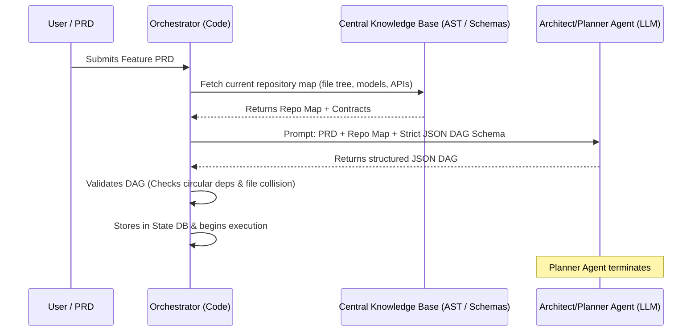

# DAG Specification and Generation

In an autonomous software factory, a feature cannot be executed as a giant, monolithic prompt. The requirements must be parsed, architected, and decomposed into a **Directed Acyclic Graph (DAG)** of discrete, dependency-ordered tasks.

---

## How the Task Graph is Born

The DAG is created through a structured interaction between deterministic code and an ephemeral **Architect/Planner Agent**:



---

## The JSON Schema of a Task Node

The output from the Planner Agent must conform to a strict schema. Below is a production-grade specification for a single node within the DAG:

```json
{
  "task_id": "T2_stripe_webhook_handler",
  "name": "Implement Stripe Webhook Handler",
  "required_role": "BACKEND_CODER",
  "dependencies": ["T1_db_schema_billing"],
  
  "context_requirements": {
    "inherited_artifacts": [
      {
        "from_task": "T1_db_schema_billing",
        "artifact_type": "PRISMA_SCHEMA"
      },
      {
        "from_task": "T1_db_schema_billing",
        "artifact_type": "EXPORTED_TYPES"
      }
    ],
    "file_system_scope": {
      "writable_files": [
        "src/api/webhooks/stripe.ts",
        "tests/api/webhooks/stripe.test.ts"
      ],
      "read_only_files": [
        "prisma/schema.prisma",
        "src/types/billing.d.ts"
      ]
    }
  },

  "acceptance_criteria": [
    "Must verify Stripe signature header using STRIPE_WEBHOOK_SECRET",
    "Must handle checkout.session.completed event idempotently",
    "Must update database order status to 'PAID'",
    "Must return 200 OK for valid events and 400 for bad signatures"
  ],

  "verification_command": "npm test tests/api/webhooks/stripe.test.ts",
  "timeout_seconds": 600
}
```

---

## Deterministic Validation Rules

Before the Orchestrator accepts any generated DAG into its database, it runs three deterministic validation passes:

### 1. Cycle Detection (Acyclicity Check)
The graph must be strictly acyclic. The orchestrator runs a topological sort (e.g., using Kahn's algorithm or Python's `networkx`):
```python
import networkx as nx

def validate_acyclic(tasks):
    G = nx.DiGraph()
    for task in tasks:
        G.add_node(task["task_id"])
        for dep in task["dependencies"]:
            G.add_edge(dep, task["task_id"])
            
    if not nx.is_directed_acyclic_graph(G):
        raise ValueError("Invalid DAG: Circular dependency detected!")
```

### 2. Dependency Existence Check
Every task listed in `dependencies` must correspond to a valid task ID defined in the graph or an already completed task in the database.

### 3. File Collision Check (Partitioning Invariant)
Tasks that run in parallel must **not** have overlapping `writable_files`. If Task 2 and Task 3 are unblocked at the same time and both write to `src/utils/helpers.ts`, the Orchestrator rejects the DAG and asks the Planner to separate shared utilities into a prerequisite task.

---

## Related Notes
- [[02-event-driven-dependency-resolution|Event-Driven Dependency Resolution]]
- [[03-dynamic-dag-mutation-and-blast-radius|Dynamic DAG Mutation and Blast Radius Analysis]]
- [[01-context-scoping-and-contract-first|Context Scoping and Contract-First Development]]
- [[02-just-in-time-prompt-hydration|Just-In-Time (JIT) Prompt Hydration]]
