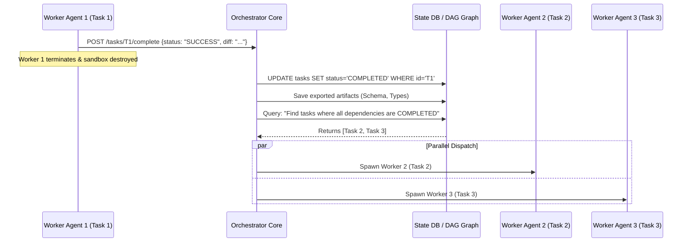

# Event-Driven Dependency Resolution

A frequent question in agentic orchestration is: **"When Task 1 finishes, how does the Orchestrator know that the state updated, and how does it trigger Tasks 2 and 3?"**

The Orchestrator does not poll or guess. It operates as an **Event-Driven Reactive State Machine**. When a worker agent completes its task inside a sandbox, it emits an explicit completion event.

---

## The End-to-End Resolution Sequence



---

## The Dependency Resolution Algorithm

The core logic executed by the Orchestrator whenever *any* task completes:

```python
def on_task_completed(completed_task_id: str, artifacts: dict):
    # 1. Atomically update the completed task's status
    state_db.update_status(completed_task_id, "COMPLETED")
    state_db.save_artifacts(completed_task_id, artifacts)
    
    # 2. Get all downstream tasks that depend on this completed task
    downstream_tasks = state_db.get_dependents(completed_task_id)
    
    # 3. Check readiness for each downstream task
    for task in downstream_tasks:
        if task.status == "PENDING":
            # Check if EVERY dependency of this task is now COMPLETED
            all_deps_satisfied = all(
                state_db.get_status(dep_id) == "COMPLETED"
                for dep_id in task.dependencies
            )
            
            # 4. If all dependencies are satisfied, dispatch immediately
            if all_deps_satisfied:
                state_db.update_status(task.id, "READY")
                dispatch_worker(task)
```

---

## Implementation Patterns

### Pattern A: In-Memory Async Concurrency (Simple Prototype)
Using Python `asyncio.Event` or JavaScript `Promise` locks:

```python
import asyncio

async def run_factory_workflow(dag):
    # Map each task ID to a notification signal
    completion_events = {task.id: asyncio.Event() for task in dag.tasks}

    async def worker_pipeline(task):
        # 1. Await all prerequisite task completion signals
        for dep_id in task.dependencies:
            await completion_events[dep_id].wait() # Non-blocking wait

        # 2. All prerequisites satisfied: execute agent in sandbox
        print(f"--> Dispatched agent for: {task.id}")
        await execute_agent_in_sandbox(task)

        # 3. Signal downstream tasks that this task is complete
        completion_events[task.id].set()

    # Launch all tasks concurrently; each automatically resolves dependencies
    await asyncio.gather(*(worker_pipeline(t) for t in dag.tasks))
```

### Pattern B: Distributed Message Queue (Production Standard)
In enterprise environments with distributed worker pools:
1. **Agent Finishes**: Worker container sends a signed HTTP payload or writes to Redis:
   ```json
   {
     "event": "TASK_COMPLETED",
     "task_id": "T1_db_schema",
     "status": "SUCCESS",
     "git_commit": "a1b2c3d4",
     "artifacts": {
       "EXPORTED_TYPES": "src/types/billing.d.ts"
     }
   }
   ```
2. **Orchestrator Consumes**: The event listener marks `T1` as `COMPLETED` in PostgreSQL.
3. **Queue Push**: The resolver identifies `T2` and `T3` as `READY` and pushes job payloads to a Redis queue (`tasks:ready:queue`).
4. **Worker Pool Pull**: Idle worker containers pull jobs and execute immediately in parallel.

---

## Related Notes
- [[01-dag-specification-and-generation|DAG Specification and Generation]]
- [[03-dynamic-dag-mutation-and-blast-radius|Dynamic DAG Mutation and Blast Radius Analysis]]
- [[01-ephemeral-worker-lifecycle|Ephemeral Worker Lifecycle and Elasticity]]
- [[02-just-in-time-prompt-hydration|Just-In-Time (JIT) Prompt Hydration]]
