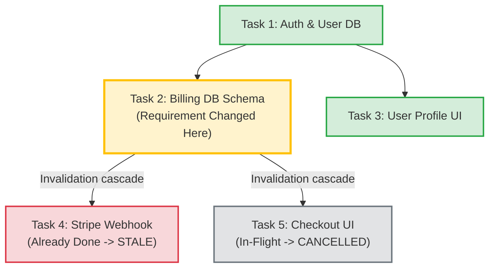
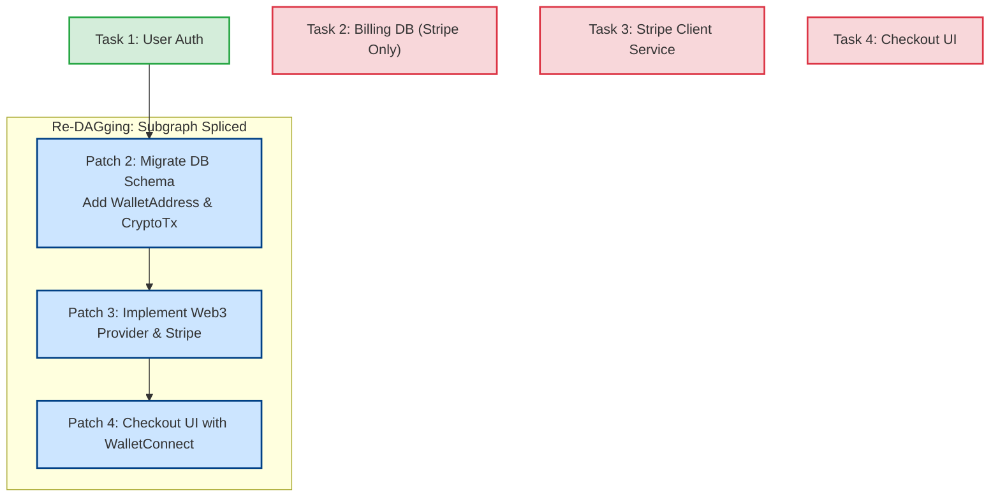
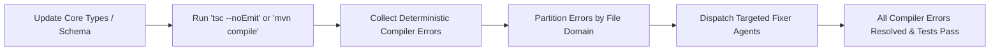

# Dynamic DAG Mutation and Blast Radius Analysis

In enterprise application development, **requirements change mid-flight**. A client pivots, a compliance mandate alters data storage rules, or a frontend requirement reveals that an upstream database schema is inadequate.

A naive factory would have to scrap everything and restart from scratch. An advanced software factory treats the DAG as **dynamic and mutable**, using **Blast Radius Analysis** and **Subgraph Splicing**.

---

## 1. The Blast Radius: Invalidation Cascades

When a requirement changes, the Orchestrator does not wipe the repository. It calculates the **Blast Radius**—the exact subtree in the DAG affected by the change:

### The State Classifications:
1. **Untouched / Immune (T1, T3)**: Nodes whose inputs and contracts remain unaffected. Their code and tests are preserved intact.
2. **Changed / Root Cause (T2)**: The earliest node where the new requirement deviates from the old specification.
3. **Stale / Dirty (T4)**: Nodes that already ran to completion, but were built on assumptions or types that are no longer valid.
4. **Cancelled (T5)**: In-flight workers currently executing. The Orchestrator immediately fires a cancellation signal to kill their sandbox containers and stop burning compute/tokens.

---

## 2. Bidirectional Ripple: When Downstream Breaks Upstream

Requirement changes rarely flow only downwards. Frequently, a change in a downstream requirement breaks an upstream foundation:

> **Example:** While implementing Task 4 (*Checkout UI*), the user demands: *"We need customers to pay with crypto (USDC/Ethereum), not just credit cards."*
> Although requested at the UI stage, this requires adding `wallet_address` and `transaction_hash` to the database schema (Task 2: Upstream).

### Subgraph Splicing Algorithm

1. **PRD Diffing**: An agent compares `PRD_v1` vs. `PRD_v2`.
2. **Reverse Traceback**: The Planner traces upward to locate the earliest ancestor affected (`Task 2`).
3. **Invalidate Subtree**: The Orchestrator invalidates `Task 2` and its descendants.
4. **Splice Patch DAG**: The Planner outputs a replacement sub-DAG (`Patch 2`, `Patch 3`, `Patch 4`) and inserts it into the graph.

---

## 3. Git Atomic Checkpoints and Rollbacks

Every completed task in the factory automatically commits its result with a deterministic Git tag:
`checkpoint/<task_id>` (e.g., `checkpoint/T1_auth`).

When a subtree is invalidated:
- The Orchestrator performs a `git checkout` to the last clean, unaffected ancestor commit (`checkpoint/T1_auth`).
- Unaffected branches continue their work without interruption.

---

## 4. Rewrite vs. Refactor Decision Matrix

When tasks are invalidated, the factory decides between two recovery modes:

| Mode | When Used | Mechanism |
| :--- | :--- | :--- |
| **Clean Invalidation (Scrap & Redo)** | Early stage, or small isolated tasks (< 200 lines). | Discard branch diffs. Re-run clean task from new spec. |
| **Migration / Refactor Mode** | Late stage, complex enterprise codebases with existing tests. | Spawn a **Refactor Agent** with the existing code + new spec + compiler errors. |

---

## 5. Compiler-as-a-Sensor for Guided Refactoring

In enterprise systems, do not ask an LLM to guess what broke after a requirement change. Use the **deterministic compiler/type-checker as a sensor**:

1. Update the database schema and type definitions.
2. Run the compiler (`tsc --noEmit` or `mvn compile`).
3. The compiler emits an exact list of every broken file and method signature across the repository.
4. The Orchestrator groups these errors by file domain and dispatches parallel **Fixer Agents** to resolve them.

---

## Related Notes
- [[01-dag-specification-and-generation|DAG Specification and Generation]]
- [[02-event-driven-dependency-resolution|Event-Driven Dependency Resolution]]
- [[02-architecture-manifest-and-adrs|Architecture Manifest and ADRs]]
- [[04-evolutionary-architecture|Evolutionary Architecture: Monolith to Microservices]]
