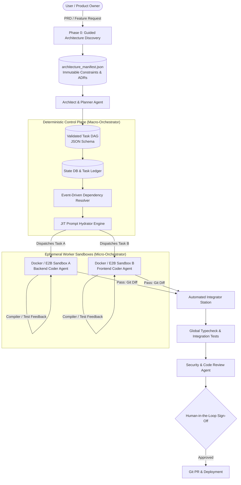

# Autonomous Software Factory — Architecture & Knowledge Base

An architectural blueprint and engineering reference for designing, building, and operating an **Agentic Software Factory**: an industrial-grade software engineering engine powered by autonomous multi-agent orchestration, deterministic control planes, and verified execution sandboxes.

---

## 🏗️ Architecture Overview



---

## 📂 Repository & Vault Structure

This repository is organized as an **Obsidian-compatible knowledge base** with strict YAML frontmatter, wikilinks, and modular documentation:

```text
my-knowledge-base/
├── README.md                      # GitHub landing page & Map of Content (MOC)
├── attachments/                   # Architecture diagrams and assets
├── 00-meta/
│   └── index.md                   # Complete Obsidian vault navigation index
└── 01-topics/
    ├── software-factory-core/     # Industrial software engineering & agentic paradigms
    ├── orchestration-engine/      # Orchestrator frameworks, determinism, & two-tier hybrid design
    ├── task-graph-and-dag/        # DAG schemas, event resolution, & dynamic mutations
    ├── context-and-prompt-engineering/ # Contract-first scoping & JIT prompt hydration
    ├── agent-runtime-and-sandboxing/   # Ephemeral worker pools, blueprints, & sandboxes
    └── architectural-governance/  # Phase 0 discovery, manifests, archetypes, & evolutionary design
```

---

## 🗺️ Map of Content (MOC)

### 1. Software Factory Foundations
- [What is a Software Factory?](01-topics/software-factory-core/01-what-is-a-software-factory.md) — Moving from artisanal, hand-crafted coding to standardized industrial assembly lines.
- [The Agentic Software Factory Paradigm](01-topics/software-factory-core/02-agentic-software-factory-paradigm.md) — The five core pillars: Orchestration, Ephemeral Agents, Sandboxes, Shared Intelligence, and Human-in-the-Loop.

### 2. Orchestration Engine Architecture
- [Orchestration Frameworks Comparison](01-topics/orchestration-engine/01-orchestration-frameworks-comparison.md) — In-depth evaluation: Temporal / Inngest vs. LangGraph / AutoGen vs. Custom DAG Runners.
- [Deterministic Macro-Orchestrator Architecture](01-topics/orchestration-engine/02-deterministic-macro-orchestrator.md) — Why the macro-orchestrator **must** be deterministic code, not an AI agent.
- [Two-Tier Hybrid Orchestration Pattern](01-topics/orchestration-engine/03-two-tier-hybrid-orchestration.md) — Separating long-running macro state persistence from fast, cyclic micro-agent reasoning loops.

### 3. Task Graph & DAG Execution
- [DAG Specification and Generation](01-topics/task-graph-and-dag/01-dag-specification-and-generation.md) — Decomposing PRDs into validated, acyclic JSON task graphs with Kahn's algorithm.
- [Event-Driven Dependency Resolution](01-topics/task-graph-and-dag/02-event-driven-dependency-resolution.md) — How the state machine detects task completions and triggers downstream parallel tasks.
- [Dynamic DAG Mutation and Blast Radius Analysis](01-topics/task-graph-and-dag/03-dynamic-dag-mutation-and-blast-radius.md) — Managing mid-flight requirement changes, bidirectional cascades, and subgraph splicing.

### 4. Context & Prompt Engineering
- [Context Scoping and Contract-First Development](01-topics/context-and-prompt-engineering/01-context-scoping-and-contract-first.md) — Solving context bloat and token degradation via interface contracts and file partitioning.
- [Just-In-Time (JIT) Prompt Hydration](01-topics/context-and-prompt-engineering/02-just-in-time-prompt-hydration.md) — Why the DAG stores recipes instead of raw prompts; dynamic runtime prompt compilation.
- [Codebase Intelligence Layer and Shared Memory](01-topics/context-and-prompt-engineering/03-codebase-intelligence-layer.md) — AST symbol tables and specification ledgers vs. the "God Agent" anti-pattern.

### 5. Agent Runtime & Sandboxing
- [Ephemeral Worker Lifecycle and Elasticity](01-topics/agent-runtime-and-sandboxing/01-ephemeral-worker-lifecycle.md) — Agents as short-lived serverless pods; dynamic worker scaling and resource reclamation.
- [Agent Registry and Blueprints](01-topics/agent-runtime-and-sandboxing/02-agent-registry-and-blueprints.md) — Version-controlled YAML specs defining models, tools, and permission guardrails.
- [Execution Sandboxes and Isolation](01-topics/agent-runtime-and-sandboxing/03-execution-sandboxes-and-isolation.md) — Docker, E2B microVMs, git worktrees, and error-driven self-correcting feedback loops.

### 6. Architectural Governance & Evolution
- [Guided Architecture Discovery (Phase 0)](01-topics/architectural-governance/01-guided-architecture-discovery.md) — Interactive intake wizard to prevent intent mismatches and AI bias.
- [Architecture Manifest and ADRs](01-topics/architectural-governance/02-architecture-manifest-and-adrs.md) — The `architecture_manifest.json` contract and automated architectural linters (ArchUnit).
- [Factory Archetypes and Chassis Platforms](01-topics/architectural-governance/03-factory-archetypes-and-chassis.md) — Pre-engineered chassis kits (Java/Spring/Kafka, Next.js, Go/gRPC) to eliminate boilerplate hallucinations.
- [Evolutionary Architecture: Monolith to Microservices](01-topics/architectural-governance/04-evolutionary-architecture.md) — Domain boundary enforcement, Modular Monolith foundation, and automated Saga/Outbox microservice extraction.

---

## ⚡ Core Principles Summary

1. **Deterministic Spine, Probabilistic Workers**: Code controls the workflow, state, and git branches; LLMs are ephemeral workers invoked at specific stations.
2. **Contract-First Scoping**: Tasks expose interface contracts (types, schemas), not raw implementation code.
3. **Compile and Test Everything**: Code generated by agents is never accepted without passing verification inside an isolated sandbox.
4. **Mutate, Don't Discard**: When requirements pivot, calculate the blast radius and splice patch sub-DAGs into the graph.
5. **Evolve Systematically**: Start with clean domain boundaries in a Modular Monolith before splitting into distributed microservices.

---

## 📖 Using with Obsidian
Open `/home/gmhossen/Project/my-knowledge-base` as a vault in [Obsidian](https://obsidian.md/) to take advantage of internal wikilinks, visual graph views, and metadata tags.
